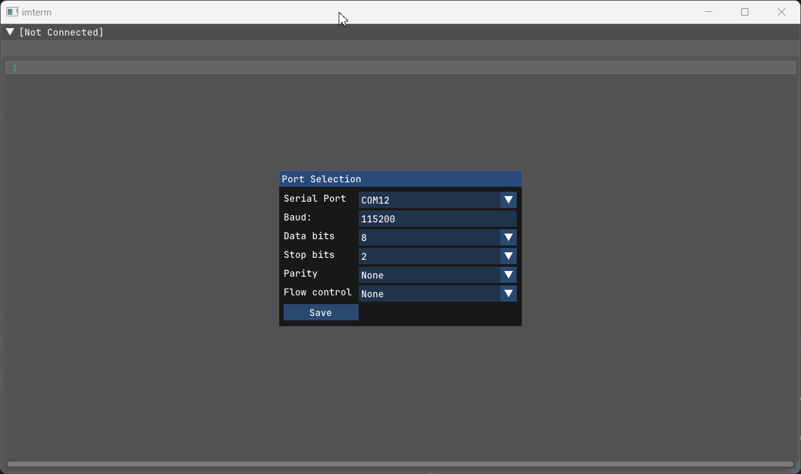

# imterm

imterm is a graphical UART terminal for embedded systems development, with
ESP32-style console input and a supported subset of ANSI/VT commands.

- ANSI colors and cursor control, plus console line editing and history keys.
- Scrollback, text search, selection, and clipboard copy/paste.
- UTF-8 input and display, with adjustable interface zoom.
- Optional line numbers and timestamps, text logging, and raw serial-byte capture.
- Automatic reconnect when a serial device returns.
- DTR/RTS controls and CTS/DSR/DCD status, where supported by the device.

Written in C++20 using [Dear ImGui](https://github.com/ocornut/imgui), GLFW, and
Vulkan. Windows and Linux have been tested. Serial ports are the only supported
transport; the application is still under active development. A Vulkan-capable
graphics driver is required to run it.

An ESP32-C6 console session showing tab completion:



## Building

With a C++20 compiler, CMake 3.24 or newer, Conan 2, and a build tool on `PATH`,
run from the repository root in a Linux/Bash environment:

```sh
./scripts/bootstrap.sh
cmake --preset conan-debug
cmake --build --preset conan-debug
./out/conan/build/Debug/imterm
```

The bootstrap script installs Debug and Release dependencies and generates CMake
presets. Install any system packages it reports as missing. GLFW and ImGui come
from Conan by default; their submodules are optional build alternatives.

## Documentation

- [Build setup, Windows instructions, and troubleshooting](docs/building.md)
- [Running tests, sanitizers, and fuzzing](tests/README.md)
- [Raw capture and serial-output diagnostics](docs/raw-capture.md)
- [Supported terminal commands and UTF-8 behavior](docs/terminal-semantics.md)

The terminal view originated from
[ImGuiColorTextEdit](https://github.com/BalazsJako/ImGuiColorTextEdit).
See [LICENSE](LICENSE) for licensing.
