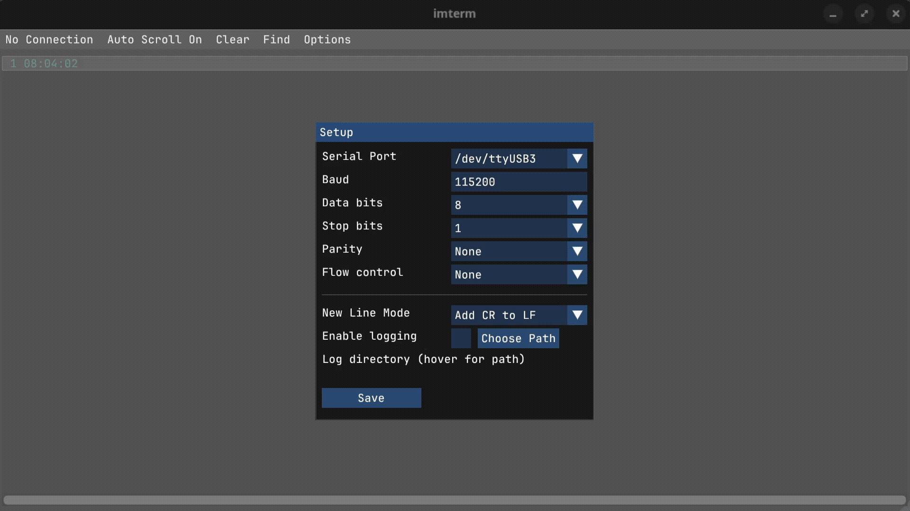

# imterm

imterm is a graphical serial (UART) terminal for embedded systems development.
It supports ANSI colors and cursor control, ESP32-style console interaction,
scrollback search, UTF-8, and logging. It runs on Linux and Windows and requires
a Vulkan-capable graphics driver.



## Quick start

### Build and launch

You need a C++20 compiler, CMake 3.24 or newer, Make or Ninja, and Python 3 with
virtual-environment support. The commands below use Linux/Bash; see the
[build guide](docs/building.md#windows) for Windows.

```sh
git clone https://github.com/stevenoonan/imterm.git
cd imterm

python3 -m venv .venv
. .venv/bin/activate
python -m pip install 'conan>=2,<3'

./scripts/bootstrap.sh
cmake --preset conan-debug
cmake --build --preset conan-debug
./out/conan/build/Debug/imterm
```

If you already have the source, start at `python3 -m venv .venv`. If Conan 2 is
already on your `PATH`, skip the Python environment steps.

Bootstrap downloads/builds Debug and Release dependencies and generates the
CMake presets. If it reports missing system development packages, install the
listed packages and run it again. Git submodules are optional. See the
[build guide](docs/building.md) for Release builds and troubleshooting.

### Connect to a device

1. Plug in your board or USB-to-UART adapter. In **Setup**, select its **Serial
   Port** (`/dev/ttyUSB0` or `/dev/ttyACM0` on Linux; `COM3`, for example, on Windows).
2. Match the device's baud rate, data bits, stop bits, parity, and flow control.
   A common ESP32 configuration is **115200 baud, 8 data bits, 1 stop bit,
   parity None, flow control None**. Set **Stop bits** explicitly; imterm's
   initial default is 2.
3. Leave **New Line Mode** on **Strict** for CRLF output. For LF-only output,
   choose **Add CR to LF**; for CR-only output, choose **Add LF to CR**.
4. Click **Save** to connect, then click inside the terminal and type a command.
   Enter sends LF. Tab completion, command editing, and history depend on the
   console running on your device.

Use the menu named after the port to change parameters, disconnect, or toggle
**Auto Reconnect**. Automatic reconnect is enabled by default after an
established connection drops. On Linux, a permission error means your account
needs access to the serial device; see [serial access](docs/building.md#serial-port-access).

Settings are saved in `imterm.toml` in the directory you launch from. Startup
opens Setup with those values; click **Save** to connect.

## Everyday controls

| Action | Control |
| --- | --- |
| Find text | **Find** or **Ctrl+F**; Enter/Shift+Enter in the search field moves to the next/previous match |
| Select text | Left-drag; double-click a word or triple-click a line; **Ctrl+A** selects all |
| Copy | **Ctrl+Insert**, or right-click a selection (also clears the selection) |
| Paste | **Ctrl+V**, **Shift+Insert**, or right-click with no selection |
| Interrupt the device | **Ctrl+C** sends the interrupt byte; use the copy controls above to copy text |
| Zoom | **Ctrl++**, **Ctrl+-**, **Ctrl+0**, Ctrl+mouse wheel, or **Options → View → Zoom** |
| Inspect scrollback | Turn **Auto Scroll Off**, then scroll; **Ctrl+Home/End** goes to the top/bottom |
| Line numbers and timestamps | **Options → View** |
| Clear the terminal | **Clear** |

For readable text logs, enable **Enable logging** in Setup and select a directory
with **Choose Path**. The default is `~/imterm/logs` on Linux or
`%USERPROFILE%\imterm\logs` on Windows. **Options → Log** controls logging and
log line numbers/timestamps. Line timestamps reflect the most recent content
change to each line.

For exact received bytes, use **Options → Raw Capture → Start...**, then
**Options → Raw Capture On → Stop**. [Raw capture](docs/raw-capture.md) preserves
escape sequences and original bytes separately from text logs.

DTR/RTS controls and CTS/DSR/DCD status appear when connected, subject to device
support. Hardware flow control disables manual RTS.

Serial ports are the only transport. imterm implements a
[subset of ANSI/VT](docs/terminal-semantics.md), with one cell per Unicode scalar;
wide-character layout and font fallback are not supported.

## Documentation

- [Build setup, Windows instructions, and troubleshooting](docs/building.md)
- [Running tests, sanitizers, and fuzzing](tests/README.md)
- [Raw capture and serial-output diagnostics](docs/raw-capture.md)
- [Supported terminal commands and UTF-8 behavior](docs/terminal-semantics.md)
- [Settings format, validation, and recovery](docs/configuration.md)
- [Capture session ownership, connection states, and I/O](docs/capture-session.md)
- [Terminal view components, input, and selection](docs/terminal-view.md)
- [Application lifetime and module architecture](docs/architecture.md)
- [Refactoring roadmap](REFACTORING_PLAN.md)

Written in C++20 using [Dear ImGui](https://github.com/ocornut/imgui), GLFW, and
Vulkan. The terminal view is based on
[ImGuiColorTextEdit](https://github.com/BalazsJako/ImGuiColorTextEdit).
See [LICENSE](LICENSE) for licensing.
